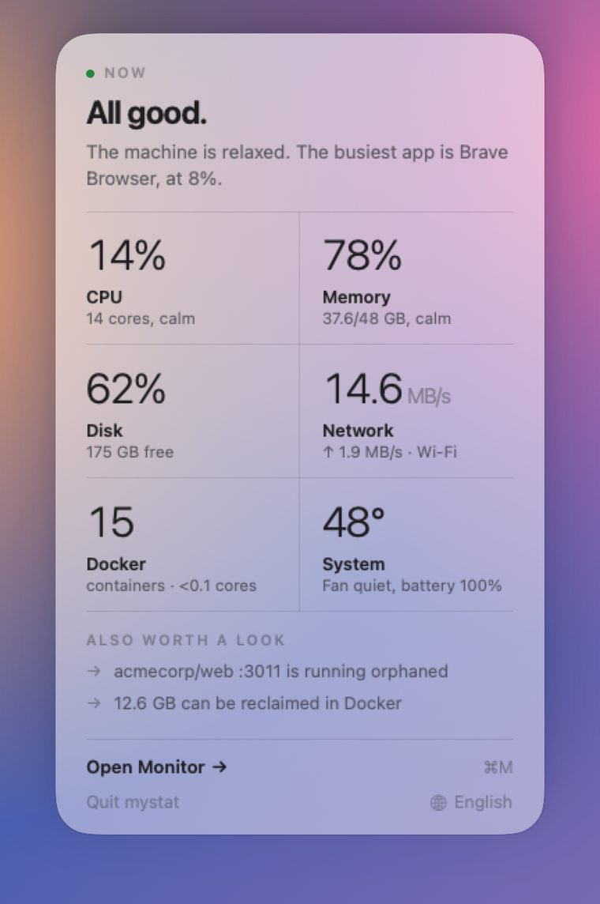
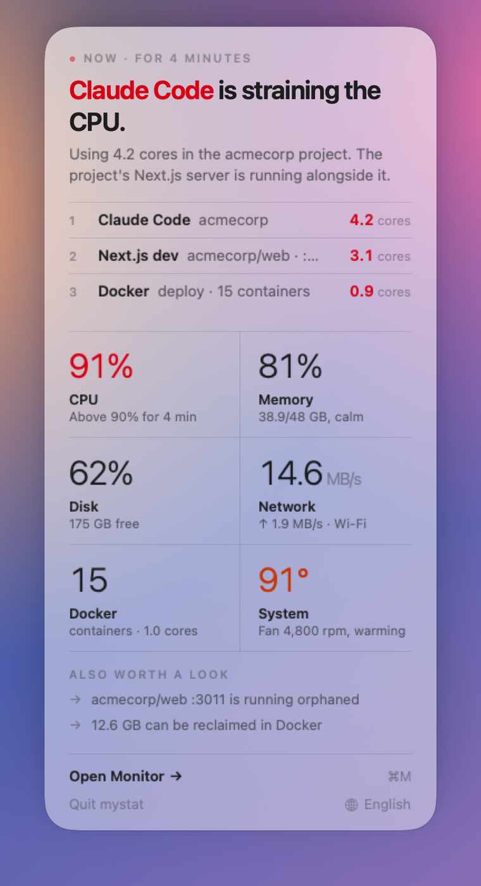
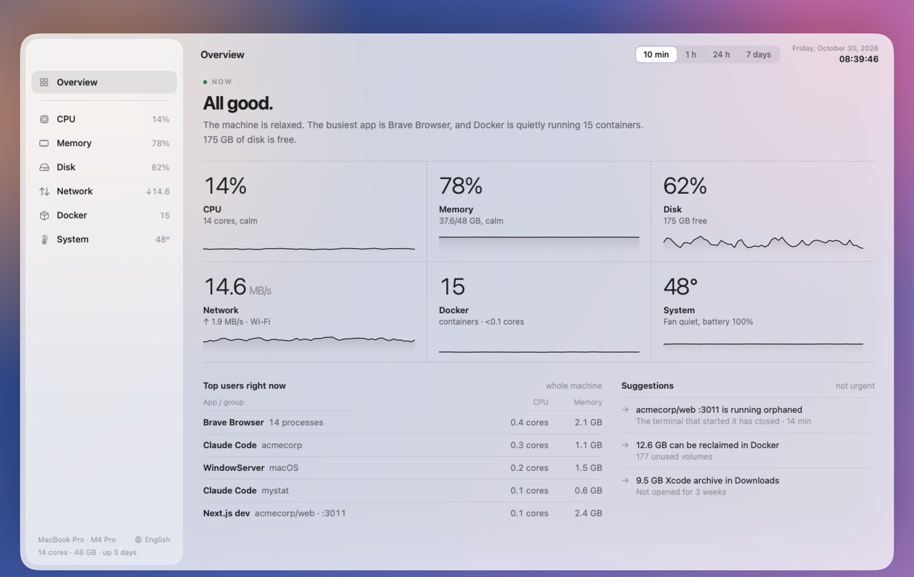
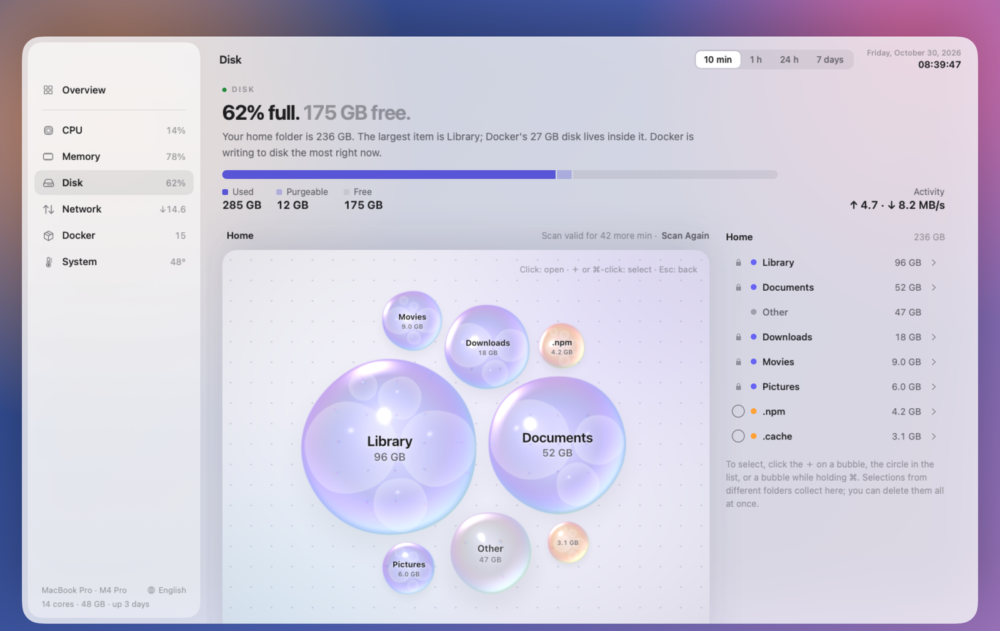

<p align="center">
  
</p>

<h1 align="center">mystat</h1>

<p align="center">A calm system monitor for the macOS menu bar.<br>It tells you what's going on in one sentence, and who's responsible when something isn't right.</p>

<p align="center">
  
  
</p>

## Features

- **One glance in the menu bar.**
  - CPU, memory and disk usage, network speed, date and time in a single compact block.
  - When something needs attention, a temperature, battery or Docker item appears next to it.
- **A panel that explains.**
  - "All good." or "Claude Code is straining the CPU.", with the culprits, how long it has been going on, and a link to the details.
- **Incidents, not just numbers.** mystat watches for:
  - sustained CPU load;
  - memory pressure;
  - low disk space;
  - a busy or failing Docker container;
  - heat;
  - fast battery drain.
- **A monitor window** with Overview, CPU, Memory, Disk, Network, Docker and System sections.
  - Charts cover 10 minutes, 1 hour, 24 hours and 7 days.
  - Processes are grouped the way you think about them: by app, by project, by dev server.
- **Disk map.**
  - Scan your home folder and see what takes up space.
  - Pick items from different folders, then move them to the Trash or delete them.
  - Folders macOS needs can't be selected.
- **Docker.**
  - Containers grouped by compose project, with CPU, memory and disk use.
  - Restart or stop a container.
  - Clean up unused volumes and images.
- **System.** Chip temperature and fans, power and battery health, GPU load, and the apps using the most energy.
- **English and Turkish**, switchable from the panel. More languages are welcome — see [Translating mystat](Locales/README.md).

<p align="center">
  
</p>
<p align="center">
  
</p>

## Install

1. Download `mystat-<version>.dmg` from [Releases](../../releases/latest).
2. Open it and drag **mystat** to **Applications**.
3. Open mystat from Applications. It lives in the menu bar (no Dock icon) and adds itself to Login Items, so it starts with your Mac.
   - You can turn that off in System Settings → General → Login Items & Extensions.

The app is signed with a Developer ID and notarized by Apple.

**Requirements:** macOS 26 or later on Apple silicon.

## Permissions

mystat works without any extra permission. Two are optional:

| Permission | What it unlocks |
|---|---|
| **Full Disk Access** | A complete disk map, including folders macOS protects, and the "large old file in Downloads" suggestion. |
| **Location** | The Wi‑Fi network's name. macOS ties network names to Location Services; mystat never reads or stores your location. It only asks when you click **Allow** on the Connection card in the Network section. |

If you use Docker Desktop, macOS may ask once whether mystat can access data from other apps: mystat reads the size of Docker's disk image to show how much space Docker takes.

## Privacy

- **No internet:** mystat makes no internet connections and has no analytics or telemetry. Its only network activity:
  - the local Docker socket;
  - a ping to your router, to show latency;
  - a short loopback (`127.0.0.1`) connection, to calibrate per-app network counters.
- **Local history:** charts for 24 hours and 7 days are stored only on your Mac, in `~/Library/Application Support/mystat/history.sqlite`.
- **Disk scan cache:** the last disk scan (names and sizes of the files and folders in your home folder) is cached in `~/Library/Application Support/mystat/diskscan.cache`, so the map survives a restart. It's deleted once it's more than an hour old.
- **No root:** mystat runs as a normal app; no root, no helper tool, no kernel extension.

## Build from source

You need Xcode 26 (Swift 6.2).

```sh
swift build
swift test
scripts/make-app.sh            # build/mystat.app
scripts/make-app.sh install    # copies it to ~/Applications and opens it
```

`make-app.sh` signs with your Developer ID if you have one, otherwise with your development certificate, or ad hoc. To try the UI with sample data, run `.build/debug/mystat --sample` (add `--incident` for an incident).

See [CONTRIBUTING.md](CONTRIBUTING.md) for how the code is organized.

## License

[MIT](LICENSE) © 2026 Berkay Gökçe. The disk map's circle packing is adapted from d3-hierarchy (ISC); see [THIRD_PARTY_NOTICES.md](THIRD_PARTY_NOTICES.md).
