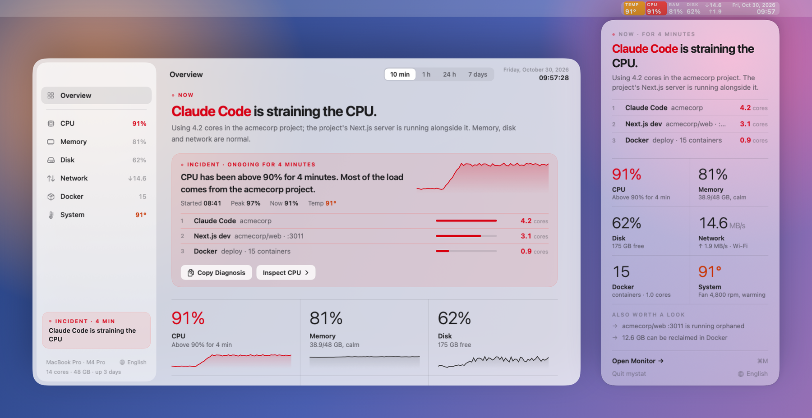
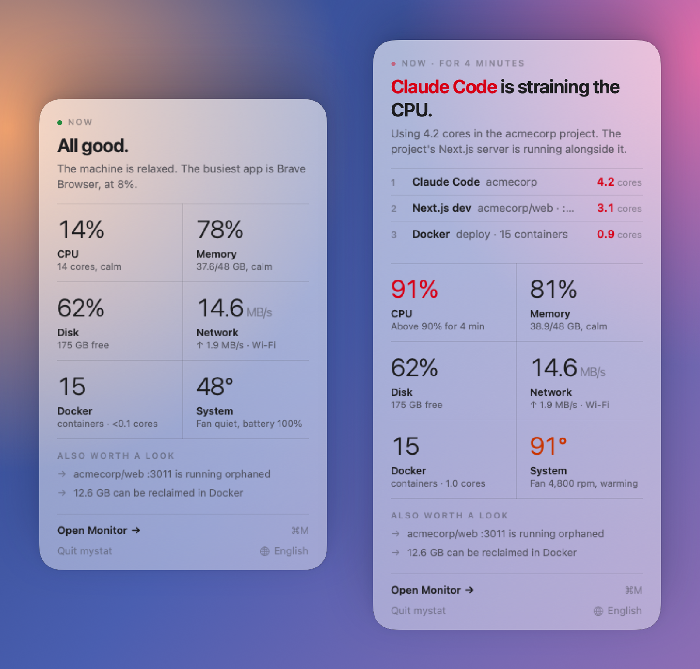
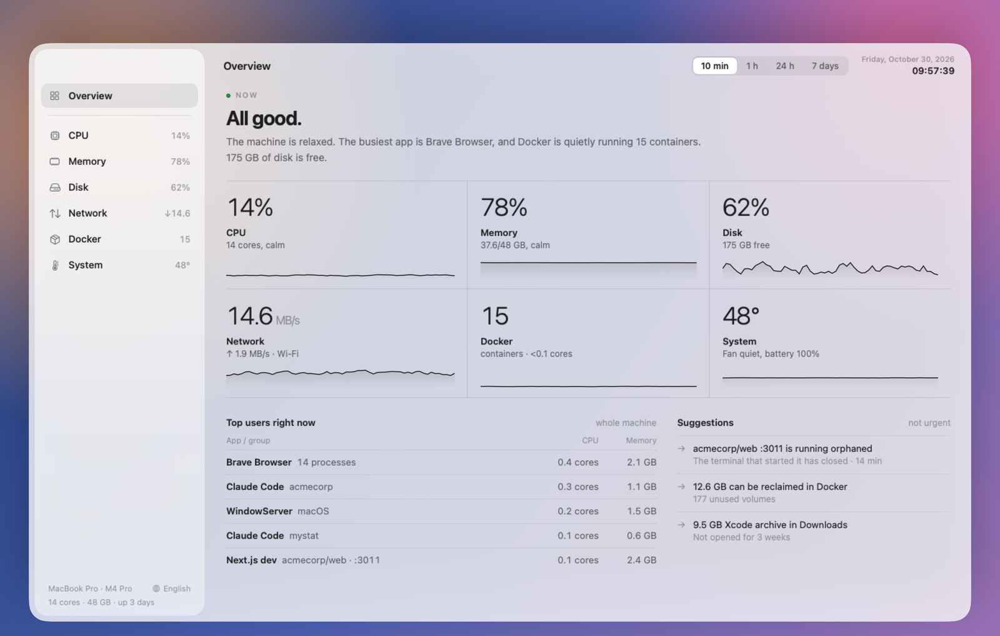
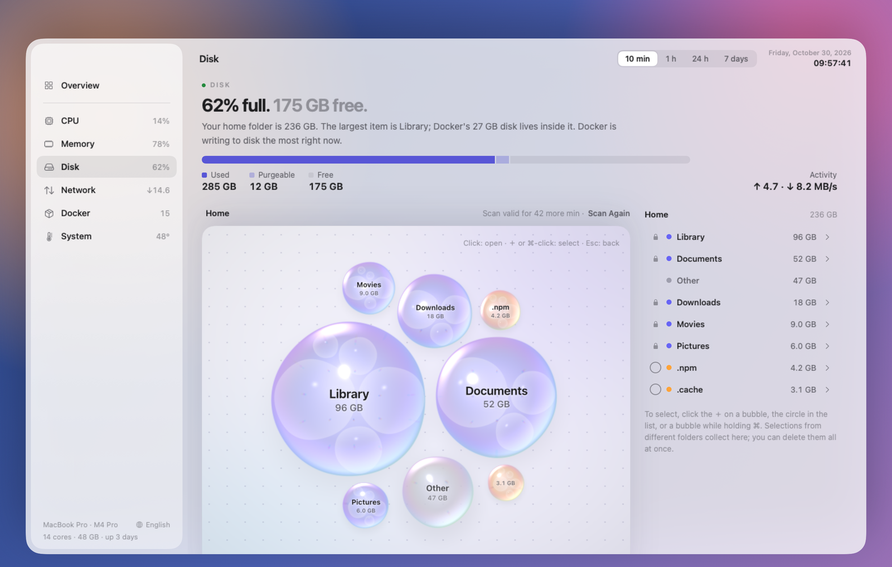
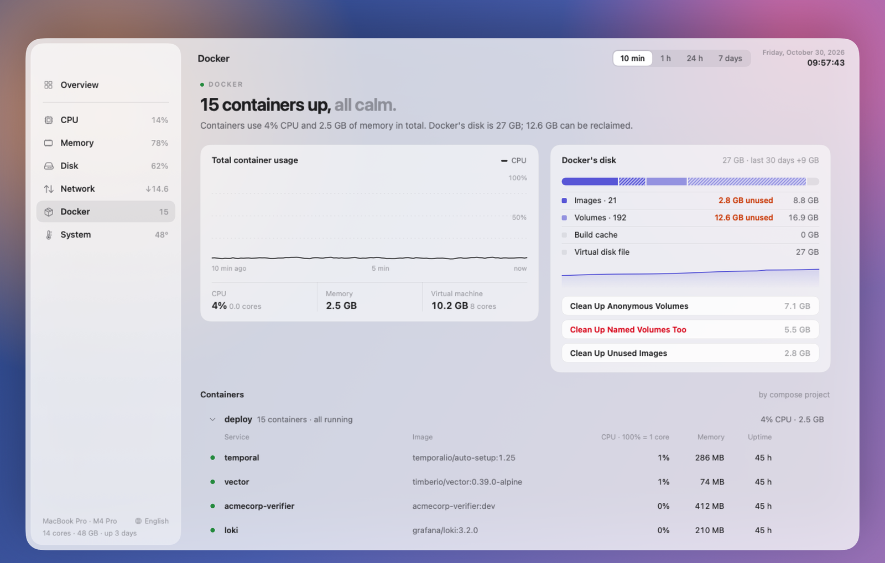
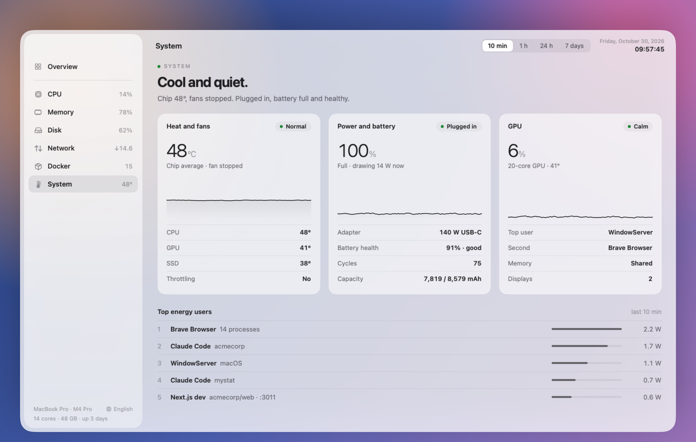

<div align="center">


<h1>mystat</h1>

<p><b>A calm system monitor for the macOS menu bar.</b><br>
It tells you what's going on in one sentence, and who's responsible when something isn't right.</p>

<p>
<a href="https://github.com/berkaygkc/mystat/releases/latest"></a>


<a href="LICENSE"></a>
<a href="https://github.com/berkaygkc/mystat/releases"></a>
</p>

<a href="https://github.com/berkaygkc/mystat/releases/latest"></a>

<p><sub>Free and open source · signed and notarized · no internet, no telemetry</sub></p>

<br>

<picture>
  <source media="(prefers-color-scheme: dark)" srcset=".github/assets/hero-dark.png">
  
</picture>

</div>

## Why mystat

Most system monitors hand you numbers and leave the reading to you. mystat reads them for you. When the machine is calm, the panel says *"All good."* When it isn't, it says *"Claude Code is straining the CPU."* and shows the culprits, how long it has been going on, and what you can do about it.

Everything runs locally, as a normal app, with a small footprint: it is meant to stay open all day.

## Features

<table>
<tr>
<td width="50%" valign="top">

#### 🧭 Menu bar at a glance
CPU, memory and disk usage, network speed, date and time in one compact block. Temperature, battery or Docker items appear next to it only when they need attention.

</td>
<td width="50%" valign="top">

#### 💬 A panel that explains
One sentence about the state of your Mac, the busiest apps behind it, and suggestions worth a look, such as a dev server left running or space Docker could give back.

</td>
</tr>
<tr>
<td valign="top">

#### 🚨 Incidents, not just numbers
mystat watches for sustained CPU load, memory pressure, low disk space, a busy or failing Docker container, heat and fast battery drain, and tells you who is behind it.

</td>
<td valign="top">

#### 📈 The monitor
Overview, CPU, Memory, Disk, Network, Docker and System sections, with charts for 10 minutes, 1 hour, 24 hours and 7 days. Processes are grouped the way you think about them: by app, by project, by dev server.

</td>
</tr>
<tr>
<td valign="top">

#### 🫧 Disk map
Scan your home folder and see what takes up space. Pick items from different folders, then move them to the Trash or delete them. Folders macOS needs can't be selected.

</td>
<td valign="top">

#### 🐳 Docker
Containers grouped by compose project, with CPU, memory and disk use. Restart or stop a container, and clean up unused volumes and images.

</td>
</tr>
<tr>
<td valign="top">

#### 🌡️ System
Chip temperature and fans, power and battery health, GPU load, and the apps using the most energy.

</td>
<td valign="top">

#### 🌍 Your language
English and Turkish, switchable from the panel. Adding a language is a single JSON file; see [Translating mystat](Locales/README.md).

</td>
</tr>
</table>

## Screenshots

<p align="center">
  
</p>

<table>
<tr>
<td width="50%"></td>
<td width="50%"></td>
</tr>
<tr>
<td align="center"><b>Overview</b>: the whole machine on one page</td>
<td align="center"><b>Disk</b>: what takes up space, as a map</td>
</tr>
<tr>
<td></td>
<td></td>
</tr>
<tr>
<td align="center"><b>Docker</b>: containers by compose project</td>
<td align="center"><b>System</b>: heat, power, battery and GPU</td>
</tr>
</table>

## Install

1. Download `mystat-<version>.dmg` from [the latest release](https://github.com/berkaygkc/mystat/releases/latest).
2. Open it and drag **mystat** to **Applications**.
3. Open mystat from Applications. It lives in the menu bar (no Dock icon) and adds itself to Login Items, so it starts with your Mac. You can turn that off in System Settings → General → Login Items & Extensions.

The app is signed with a Developer ID and notarized by Apple.

**Requirements:** macOS 26 or later on Apple silicon.

## Permissions

mystat works without any extra permission. Two are optional:

| Permission | What it unlocks |
|---|---|
| **Full Disk Access** | A complete disk map, including folders macOS protects, and the "large old file in Downloads" suggestion. |
| **Location** | The Wi‑Fi network's name. macOS ties network names to Location Services; mystat never reads or stores your location. It only asks when you click **Allow** on the Connection card in the Network section. |

If you use Docker Desktop, macOS may ask once whether mystat can access data from other apps: mystat reads the size of Docker's disk image to show how much space Docker takes.

## Privacy

- **No internet.** mystat makes no internet connections and has no analytics or telemetry. Its only network activity is the local Docker socket, a ping to your router to show latency, and a short loopback (`127.0.0.1`) connection to calibrate per-app network counters.
- **Local history.** Charts for 24 hours and 7 days are stored only on your Mac, in `~/Library/Application Support/mystat/history.sqlite`.
- **Disk scan cache.** The last disk scan (names and sizes of the files and folders in your home folder) is cached in `~/Library/Application Support/mystat/diskscan.cache`, so the map survives a restart. It's deleted once it's more than an hour old.
- **No root.** mystat runs as a normal app: no root, no helper tool, no kernel extension.

## Build from source

You need Xcode 26 (Swift 6.2).

```sh
swift build
swift test
scripts/make-app.sh            # build/mystat.app
scripts/make-app.sh install    # copies it to ~/Applications and opens it
```

`make-app.sh` signs with your Developer ID if you have one, otherwise with your development certificate, or ad hoc. To try the UI with sample data, run `.build/debug/mystat --sample` (add `--incident` for an incident).

## Contributing

Bug reports, translations and pull requests are welcome. [CONTRIBUTING.md](CONTRIBUTING.md) explains how the code is organized, and [Translating mystat](Locales/README.md) walks you through adding a language.

## License

mystat is released under the [MIT License](LICENSE). © 2026 Berkay Gökçe.

The disk map's circle packing is adapted from [d3-hierarchy](https://github.com/d3/d3-hierarchy) (ISC); see [THIRD_PARTY_NOTICES.md](THIRD_PARTY_NOTICES.md).
